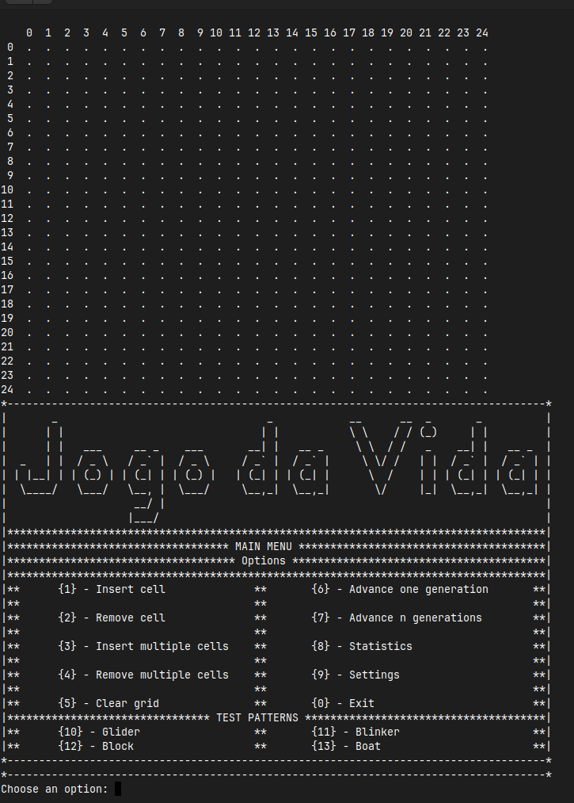
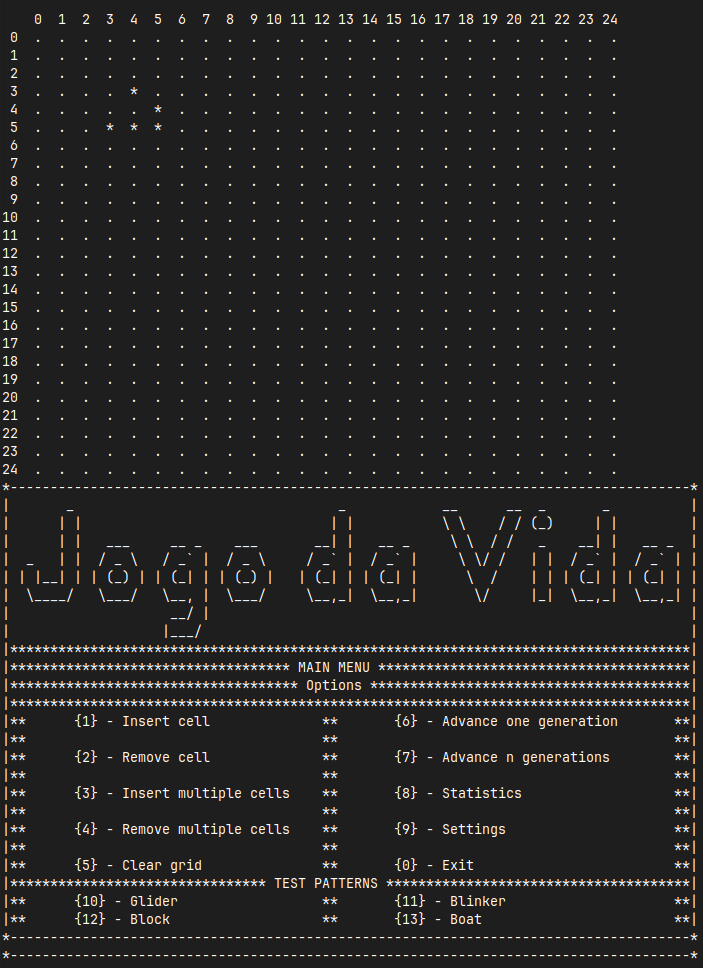
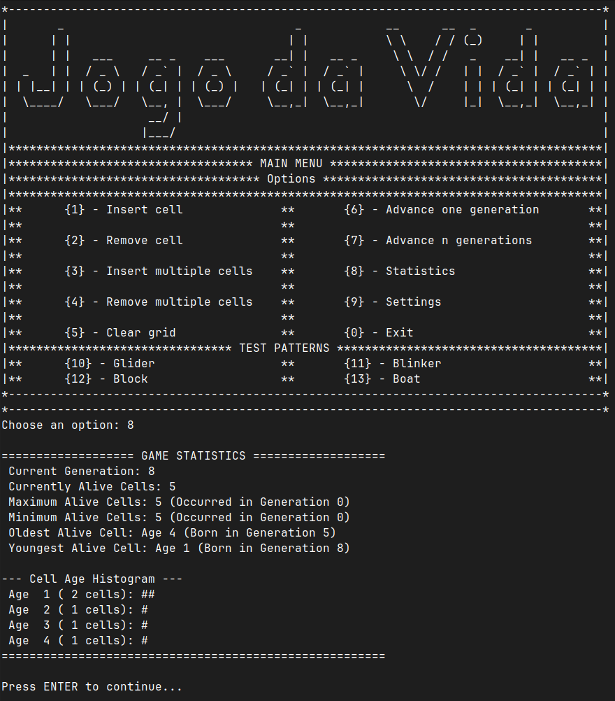

# Conway's Game of Life (Simulation Engine in C)

[](https://en.wikipedia.org/wiki/C99)
[](https://gcc.gnu.org/)
[](https://www.gnu.org/software/make/)
[](#)
[](LICENSE)

---

## Academic Identification
- **Institution:** Instituto Politécnico de Portalegre - Escola Superior de Tecnologia e Gestão (ESTG)
- **Course:** CTeSP - Tecnologias e Programação de Sistemas de Informação
- **Curricular Unit:** Programação
- **Academic Year:** 2022/2023
- **Project:** Practical Project 1 – Conway's Game of Life

---

## Application Showcase

Here are some perspectives of the application running in the terminal:

### Main Menu Interface


### Live Simulation (Glider Pattern after 8 generations)


### Real-Time Statistics & Age Histogram


---

## Table of Contents
1. [Project Overview](#1-project-overview)
2. [Conway's Genetic Laws](#2-conways-genetic-laws)
3. [Implemented Requirements & Features](#3-implemented-requirements--features)
4. [System Architecture & Modularity](#4-system-architecture--modularity)
5. [Data Structures & Key Algorithms](#5-data-structures--key-algorithms)
6. [Prerequisites & Build Instructions](#6-prerequisites--build-instructions)
7. [User Guide & Menu Navigation](#7-user-guide--menu-navigation)
8. [Test Cases & Validation](#8-test-cases--validation)
9. [Code Quality & Technical Standards](#9-code-quality--technical-standards)
10. [Authors & Academic Declaration](#10-authors--academic-declaration)

---

## 1. Project Overview
This project consists of an academic implementation in C language simulating John Horton Conway's cellular automaton known as **The Game of Life** (1970).

The environment represents an orthogonal 2D grid containing discrete cells with binary states: **alive** (`*`) or **dead** (`.`). Cells dynamically evolve through sequential discrete generations determined strictly by the state of their immediate neighborhood.

---

## 2. Conway's Genetic Laws
The simulation executes Conway's classical transitions simultaneously across all matrix elements:

1. **Survival:** Any live cell with 2 or 3 live neighbors survives into the subsequent generation.
2. **Death (Underpopulation / Overpopulation):**
   - Any live cell with 1 or 0 live neighbors dies of underpopulation/isolation.
   - Any live cell with 4 or more live neighbors dies of overpopulation.
3. **Reproduction (Birth):** Any dead cell surrounded by exactly 3 live neighbors becomes a live cell in the subsequent generation.

---

## 3. Implemented Requirements & Features
According to the official project specifications, the system delivers:

- **Single Cell Operations:** Interactive insertion and removal with real-time coordinate validation and boundary checking.
- **Batch Cell Operations:** Continuous insertion and removal loops that execute until the user explicitly signals to stop (`0`).
- **Full Grid Clearing:** Resets the board, generational clock, and population trackers.
- **Generation Stepping:**
  - Single generation advancement (`advance 1 generation`).
  - Batch simulation advancement (`advance n generations`).
- **Toroidal Topology (Infinite Grid Representation):** The grid implements periodic boundary conditions (wrap-around topology) where:
  - The rightmost column wraps to the leftmost column.
  - The uppermost row wraps to the bottommost row.
- **Real-Time Statistical Engine:**
  - Current count of live cells.
  - Maximum live cells recorded and its corresponding generation index.
  - Minimum live cells recorded and its corresponding generation index.
  - Oldest living cell's age and birth generation.
  - Youngest living cell's age and birth generation.
  - **Dynamic Age Histogram:** Aggregated graphical distribution of cell longevity rendered directly in ASCII.
- **Runtime Configuration Module:**
  - Customizable visible grid dimensions ($N \times M \le 25 \times 25$).
  - Adjustable simulation execution delay (stepping speed in seconds).
  - Configurable toggle for board rendering during multi-generation runs.
  - Configurable toggle for statistics rendering during multi-generation runs.
- **Preset Test Patterns:** Fast-loading shortcuts for canonical configurations (*Glider*, *Blinker*, *Block*, and *Boat*).

---

## 4. System Architecture & Modularity
The codebase is structured into modular directories using header resolution via `-Iinclude`:

```
├── Makefile        # Automated build configuration file
├── assets/         # Directory containing showcase images
├── include/
│   └── game.h      # Struct definitions, configurations, and function prototypes
├── src/
│   ├── game.c      # Core simulation logic, statistics engine, and toroidal algorithms
│   └── main.c      # Program entry point, control loops, and interactive menus
└── README.md       # Academic documentation and execution manual
```

---

## 5. Data Structures & Key Algorithms

### 5.1 Structures
```c
typedef struct {
    int rows;
    int cols;
    float secsPerGen;
    int showGridOnAdvance;
    int showStatsOnAdvance;
} Config;

typedef struct {
    int grid[MAX_SIZE][MAX_SIZE];
    int ages[MAX_SIZE][MAX_SIZE];
    int generation;
    int maxAlive;
    int genMaxAlive;
    int minAlive;
    int genMinAlive;
} LifeGame;
```

### 5.2 Toroidal Neighborhood Algorithm
Rather than relying on deeply nested conditional edge cases, neighbors are computed through modular arithmetic:

```c
neighborRow = (currentRow + deltaRow + totalRows) % totalRows;
neighborCol = (currentCol + deltaCol + totalCols) % totalCols;
```

Where:
- `deltaRow` and `deltaCol` range from `-1` to `1` (excluding `(0, 0)`).
- Adding `totalRows` and `totalCols` prevents negative numbers when checking the top or left borders.
- The modulo operator `%` automatically wraps borders around:
  - Row `-1` wraps to row `totalRows - 1` (top wraps to bottom).
  - Col `totalCols` wraps to col `0` (right wraps to left).

This guarantees constant-time $O(1)$ evaluation for all 8 neighboring cells across the entire grid.

### 5.3 Deterministic Generational Stepping
The next generation state is computed into auxiliary arrays (`nextGrid` and `nextAges`) before overwriting current state buffers, guaranteeing that update passes do not contaminate neighboring cell evaluations during the same generational cycle.

---

## 6. Prerequisites & Build Instructions

### Prerequisites
- **C Compiler:** GCC (MinGW-w64 on Windows or native GCC on Linux/macOS)
- **Build Tool:** `make` (or `mingw32-make` on Windows)
- **Terminal:** PowerShell, Command Prompt, or Unix Shell

### Compilation with Makefile
Open a terminal in the project root directory where the `Makefile` is located:

- **Windows (MinGW / MSYS2):**
  ```powershell
  mingw32-make
  ```
- **Linux / macOS:**
  ```bash
  make
  ```

### Direct Execution
To build and execute the application in one step:

- **Windows:**
  ```powershell
  mingw32-make run
  ```
- **Linux / macOS:**
  ```bash
  make run
  ```

### Cleaning Build Artifacts
To remove compiled executables:

- **Windows:**
  ```powershell
  mingw32-make clean
  ```
- **Linux / macOS:**
  ```bash
  make clean
  ```

---

## 7. User Guide & Menu Navigation

### Main Menu
```
*-------------------------------------------------------------------------------------*
|*********************************** MAIN MENU ***************************************|
|************************************ Options ****************************************|
|*************************************************************************************|
|**      {1} - Insert cell              **       {6} - Advance one generation       **|
|**      {2} - Remove cell              **       {7} - Advance n generations        **|
|**      {3} - Insert multiple cells    **       {8} - Statistics                   **|
|**      {4} - Remove multiple cells    **       {9} - Settings                     **|
|**      {5} - Clear grid               **       {0} - Exit                         **|
*-------------------------------------------------------------------------------------*
```

### Additional Preset Options (Direct Numeric Input)
- `{10}`: Load **Glider** (Translational oscillator / spaceship)
- `{11}`: Load **Blinker** (Period 2 oscillator)
- `{12}`: Load **Block** (Period 1 still life)
- `{13}`: Load **Boat** (Still life)

---

## 8. Test Cases & Validation

| Test ID | Test Scenario | Input Sequence | Expected Behavior / Verification |
| :---: | :--- | :--- | :--- |
| **TC-01** | Static Still Life | Option `12` (*Block*), then Option `6` | 4 cells persist indefinitely; cell ages increase consistently with each generation step. |
| **TC-02** | Period-2 Oscillator | Option `11` (*Blinker*), then Option `6` twice | Horizontal line oscillates to vertical at step 1, returns to horizontal at step 2. |
| **TC-03** | Toroidal Wrap-Around | Cells at `(0,24)`, `(1,24)`, `(2,24)` on a 25x25 board; Advance 1 generation | Cells cross into column `0` on the left border, confirming boundary wrapping. |
| **TC-04** | User Loop Stop Criterion | Option `3`, add cell, input `1`, add cell, input `0` | Insertion repeats until `0` is passed; cleanly terminates back to main menu. |
| **TC-05** | Age Longevity & Histogram | Run standard pattern for 5 steps, select Option `8` | Histogram displays bar graphs (`#`) representing exact population per age bucket. |

---

## 9. Code Quality & Standards
- **Memory Safety:** Static allocation with bounds validation prevents buffer overflows and segmentation faults.
- **Robust I/O Processing:** Standard input streams are sanitized via buffer clearing routines (`clearInputBuffer()`), neutralizing trailing newlines and malformed non-integer inputs.
- **Portability:** Clean C99 standard compliant source code with no non-standard proprietary library dependencies.

---

## 10. Authors & Academic Declaration
- **Student 1:** Pedro Real - Number: 22996
- **Student 2:** João Martins - Number: 22999
